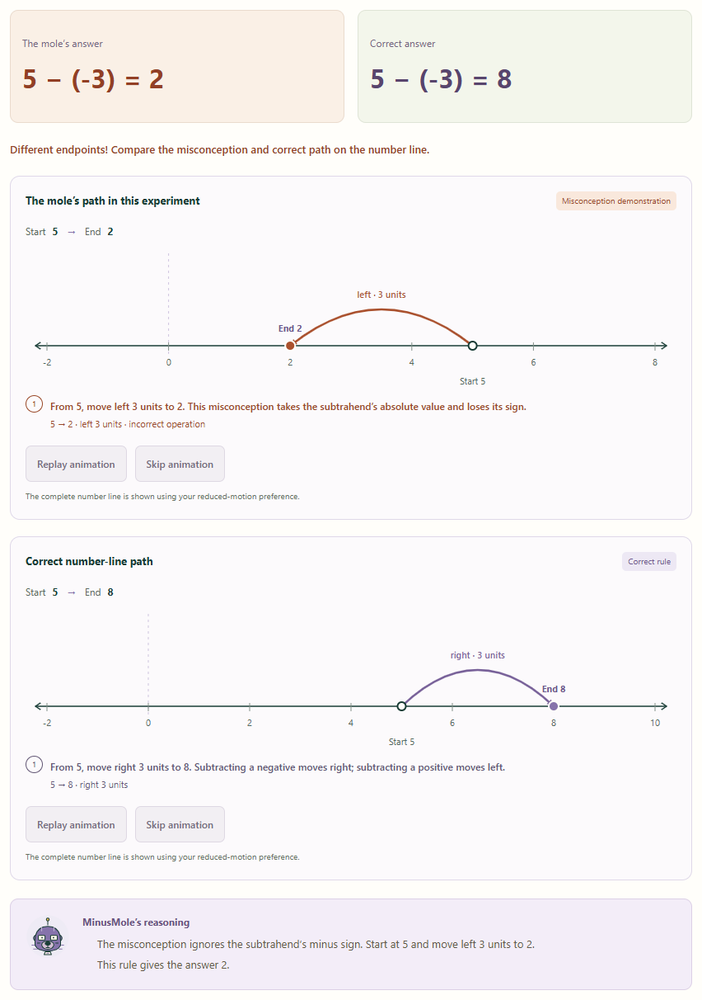
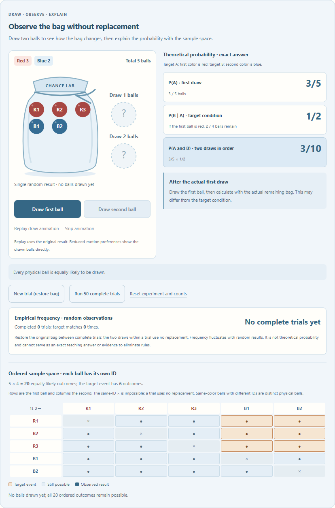

<p align="center">
  
</p>

# BugZoo — Teach the Wrong Robots

[English](#english) · [繁體中文](#繁體中文) · [简体中文](#简体中文)

## English

**An open-source educational game where students teach robots to overcome mathematical misconceptions through experiments and counterexamples.**

[Play online](https://andylamyinwik.github.io/bugzoo-teach-the-robots/) · [GitHub source](https://github.com/AndyLamyinwik/bugzoo-teach-the-robots) · [CI and public-site checks](https://github.com/AndyLamyinwik/bugzoo-teach-the-robots/actions/workflows/quality-and-pages.yml)

You are the teacher. Observe a robot's reasoning, test your ideas, and provide correct examples that challenge its faulty rules. Four playable lessons combine explainable mathematics with fraction comparisons, price changes, an interactive number line, and a probability laboratory.

- [FractionFox](https://andylamyinwik.github.io/bugzoo-teach-the-robots/#fractionfox): fraction addition.
- [DiscountPanda](https://andylamyinwik.github.io/bugzoo-teach-the-robots/#discountpanda): successive percentage discounts.
- [MinusMole](https://andylamyinwik.github.io/bugzoo-teach-the-robots/#minusmole): negative subtraction with an interactive number line.
- [ChanceCrow](https://andylamyinwik.github.io/bugzoo-teach-the-robots/#chancecrow): probability and sampling without replacement.

### Start playing

1. Open **[Play online](https://andylamyinwik.github.io/bugzoo-teach-the-robots/)**. No registration or installation is needed. Use the language selector at the top to choose English or Traditional Chinese.
2. Pick a robot from the home-page lesson cards or the top **Choose a lesson** menu; the links above also open each lesson directly.
3. Follow **Observe → Hypothesize → Experiment → Teach → Verify**. Use correct examples to eliminate mistaken rules, then pass three unseen questions alongside the corrected robot to finish.
4. Open **[My progress](https://andylamyinwik.github.io/bugzoo-teach-the-robots/#progress)** to continue a lesson, or **[Learning Passport](https://andylamyinwik.github.io/bugzoo-teach-the-robots/#passport)** to review your results and download a Markdown record. Progress stays in the current browser.

The robots use deterministic, testable rules. There is no AI API, simulated chat service, or claim of neural-network training. BugZoo is an educational activity, not a scientifically validated claim of improved grades or a certification of mathematical ability.

## 繁體中文

**學生當老師，機器人當學生。** BugZoo 是一個開源數學教學遊戲：你透過觀察錯誤推理、設計實驗與提出反例，再用正確示例幫助機器人修正數學迷思。機器人的回答由可解釋、可驗證的規則產生，不需要 AI API。

四個遊戲均可直接體驗：

- [FractionFox 分數狐狸](https://andylamyinwik.github.io/bugzoo-teach-the-robots/#fractionfox)：探索分數加法與通分。
- [DiscountPanda 折扣熊貓](https://andylamyinwik.github.io/bugzoo-teach-the-robots/#discountpanda)：理解連續折扣為何不能直接相加。
- [MinusMole 負數鼴鼠](https://andylamyinwik.github.io/bugzoo-teach-the-robots/#minusmole)：透過互動數線理解負數減法。
- [ChanceCrow 機率烏鴉](https://andylamyinwik.github.io/bugzoo-teach-the-robots/#chancecrow)：用抽球實驗探索不放回抽樣機率。

### 如何開始

1. 點選 **[進入線上遊戲](https://andylamyinwik.github.io/bugzoo-teach-the-robots/)**，不需註冊或安裝。網站上方可切換繁體中文／英文。
2. 在首頁的角色卡片選擇課程，或使用上方的「選擇課程」選單；也可以直接點選上面的機器人連結。
3. 依序完成 **觀察 → 猜想 → 實驗 → 教學 → 驗證**。自行輸入題目、比較答案，用正確示例排除錯誤規則；只剩正確規則後，與機器人一起答對三道未見題即可通關。
4. 到 **[我的學習進度](https://andylamyinwik.github.io/bugzoo-teach-the-robots/#progress)** 繼續課程，或到 **[學習護照](https://andylamyinwik.github.io/bugzoo-teach-the-robots/#passport)** 查看成果並匯出 Markdown 紀錄。進度只保存在目前瀏覽器，不會上傳或跨裝置同步。

學習護照代表完成指定遊戲挑戰，不是學科能力認證；本專案也未宣稱已經科學研究證實能提升成績。

## 简体中文

**学生当老师，机器人当学生。** BugZoo 是一个开源数学教学游戏：你通过观察错误推理、设计实验和提出反例，再用正确示例帮助机器人纠正数学误区。机器人的回答由可解释、可验证的规则生成，不需要 AI API。

四个游戏都可以直接体验：

- [FractionFox 分数狐狸](https://andylamyinwik.github.io/bugzoo-teach-the-robots/#fractionfox)：探索分数加法与通分。
- [DiscountPanda 折扣熊猫](https://andylamyinwik.github.io/bugzoo-teach-the-robots/#discountpanda)：理解连续折扣为什么不能直接相加。
- [MinusMole 负数鼹鼠](https://andylamyinwik.github.io/bugzoo-teach-the-robots/#minusmole)：通过互动数轴理解负数减法。
- [ChanceCrow 概率乌鸦](https://andylamyinwik.github.io/bugzoo-teach-the-robots/#chancecrow)：用抽球实验探索不放回抽样的概率。

### 如何开始

1. 点击 **[进入在线游戏](https://andylamyinwik.github.io/bugzoo-teach-the-robots/)**，无需注册或安装。游戏界面目前提供繁体中文和英语；本节是简体中文使用说明。
2. 在首页的角色卡片选择课程，或使用上方的课程菜单（界面显示为「選擇課程」）；也可以直接点击上面的机器人链接。
3. 依次完成 **观察 → 提出猜想 → 设计实验 → 用正确示例教学 → 完成验证**。自行输入题目、比较答案，用正确示例排除错误规则；只剩正确规则后，与机器人一起答对三道未见题即可通关。
4. 打开 **[学习进度](https://andylamyinwik.github.io/bugzoo-teach-the-robots/#progress)** 继续课程，或打开 **[学习护照](https://andylamyinwik.github.io/bugzoo-teach-the-robots/#passport)**（界面显示为「學習護照」），查看结果并下载 Markdown 记录。进度仅保存在当前浏览器，不会上传或跨设备同步。

学习护照代表完成指定游戏挑战，不是学科能力认证；本项目也未声称已经科学研究证实能够提高成绩。

---

## Meet the robots / 四個機器人

| Robot             | Topic / 教學主題                          | Misconceptions to investigate / 待探索迷思                                                                |
| ----------------- | ----------------------------------------- | --------------------------------------------------------------------------------------------------------- |
| **FractionFox**   | Fraction addition / 分數加法              | Add numerators and denominators separately; keep the first denominator / 分子分母各自相加、保留第一個分母 |
| **DiscountPanda** | Successive discounts / 連續折扣           | Add discount percentages; ignore the first discount / 百分比直接相加、忽略第一次折扣                      |
| **MinusMole**     | Integer subtraction / 負數減法            | Treat the subtracted number as positive; discard a negative result / 把減數當正數、忽略結果負號           |
| **ChanceCrow**    | Sampling without replacement / 不放回抽樣 | Assume independent draws; confuse a joint event with the second draw / 誤當獨立抽樣、混淆聯合與單一事件   |

All four lessons are playable from the home page. Progress, evidence, and completion are independent for each robot.

## Learn by teaching / 透過教學學習

Every lesson follows the same five-step loop:

1. **Observe** a wrong answer and the rule that generated its reasoning.
2. **Hypothesize** which real candidate rule explains the behavior.
3. **Experiment** with your own inputs and compare the robot with correct mathematics.
4. **Teach** with a validated correct example that eliminates incompatible rules.
5. **Verify** by answering three unseen questions alongside the corrected robot.

Guessing a rule does not eliminate it. A correct example that cannot distinguish the remaining rules is recorded without claiming progress. A wrong or invalid answer cannot become teaching evidence. Completion requires the correct rule to be the only remaining candidate, and both student and robot to pass all three unseen questions.

猜想不會直接淘汰規則。只有輸入合法、答案正確的證據才能排除不相容假設；無區分度的示例不會產生假的進步。只剩正確規則後，仍須學生與機器人完成三題未見題才能通關。

## Gameplay / 實際遊戲畫面

The screenshots use synthetic lesson inputs in fresh browser contexts, without personal learning records.



MinusMole connects subtraction to movement: subtracting a positive value moves left, while subtracting a negative value moves right. Replay and skip controls respect reduced-motion preferences.



ChanceCrow distinguishes exact theoretical probability, a single random outcome, and empirical frequency. Each physical ball has its own identity; two draws in one trial never select the same ball.

## Run locally / 本地執行

Use **Node.js 24 LTS** and **pnpm 11.25.0**, matching `package.json` and `pnpm-lock.yaml`. If pnpm is unavailable, install it with `npm install --global pnpm@11.25.0`.

Download or clone this repository, then run these commands from its root:

```sh
pnpm install --frozen-lockfile
pnpm dev
```

Open the URL printed by Vite. For a local production preview:

```sh
pnpm build
pnpm preview
```

請使用指定版本及已提交的 lockfile，避免混用套件管理器。開啟 Vite 終端輸出的實際網址；正式建置輸出位於 `dist/`。

## Check and test / 工程驗證

| Command             | Purpose / 用途                                                                   |
| ------------------- | -------------------------------------------------------------------------------- |
| `pnpm check`        | ESLint, Vitest, Prettier, Strict TypeScript, and production build / 完整工程檢查 |
| `pnpm test`         | Run Vitest once / 執行單元與邏輯整合測試                                         |
| `pnpm test:watch`   | Watch Vitest / 持續測試                                                          |
| `pnpm typecheck`    | Check app and test/config types / 型別檢查                                       |
| `pnpm lint`         | ESLint with zero warnings / 靜態檢查                                             |
| `pnpm format`       | Apply Prettier formatting / 統一格式                                             |
| `pnpm format:check` | Verify formatting / 檢查格式                                                     |
| `pnpm test:e2e`     | Chromium desktop and 320px UI flows / 真實瀏覽器流程                             |
| `pnpm test:e2e:ui`  | Open Playwright's interactive test UI / 互動測試介面                             |

`pnpm check` does not include E2E. Install Playwright Chromium once, then run the browser suite separately:

```sh
pnpm exec playwright install chromium
pnpm test:e2e
```

On a fresh Linux system, use `pnpm exec playwright install --with-deps chromium` to include required system dependencies. Existing Chrome can be selected in Windows PowerShell:

```powershell
$env:BUGZOO_E2E_CHANNEL = 'chrome'
pnpm test:e2e
```

Leave `BUGZOO_E2E_CHANNEL` unset for bundled Chromium; `msedge` selects installed Edge. The default E2E setup starts and stops its own local Vite server on port 4173. Cases use isolated browser contexts and actual UI actions; page exceptions, console errors or warnings, unexpected external requests, and asset failures fail the tests. Failed screenshots and traces live in ignored `test-results/`; the HTML report is in `playwright-report/`.

Before delivery, run the full browser suite twice consecutively with zero retries. Actual results, browser versions, and historical verification records are in [docs/VERIFICATION.md](docs/VERIFICATION.md). Production subpath and public-site test configuration are documented in [docs/DEPLOYMENT.md](docs/DEPLOYMENT.md).

## Architecture / 架構

React, TypeScript Strict Mode, Vite, and Tailwind CSS provide the interface. Vitest verifies the pure domain logic; Playwright exercises real UI flows. Four lesson UIs and the progress/passport pages load through React lazy/Suspense.

```text
src/app/                 Application composition and hash navigation
src/components/          Shared progress, inputs, and dialogs
src/features/            Lesson-specific UI and learning reports
src/domain/teaching/     Shared state, hypothesis elimination, verification guards
src/domain/{robot}/      Each robot's rules, validation, and mathematical models
src/domain/math/         Exact rational-number tools
src/progress/            Validated serialization, replay, and local storage
src/i18n/                Typed Traditional Chinese and English messages
e2e/                     Real browser acceptance tests
docs/                    Architecture, roadmap, deployment, and verification
```

The UI renders results; it does not decide whether a robot has learned. Pure domain commands validate input, check the submitted answer, evaluate candidate rules, and retain only those compatible with valid evidence. Unseen questions are selected deterministically while excluding previously seen equivalent inputs.

Mathematical correctness uses `bigint` and exact rational values. Fraction questions retain their original written numerator/denominator before applying misconception rules. Discounts use integer cents and basis points, round half-up only at the final result, and cap the additive misconception at 100%. Number-line coordinates are presentation only. ChanceCrow's random sampling cannot supply evidence for exact hypothesis elimination.

Existing hash routes (`#fractionfox`, `#discountpanda`, `#minusmole`, `#chancecrow`, `#progress`, and `#passport`) support static hosting without a server router. Vite's base path is configurable for project-site deployment. See [ARCHITECTURE.md](docs/ARCHITECTURE.md) for contracts and mathematical boundaries.

## Local data and privacy / 本地資料與隱私

- Each lesson has its own `bugzoo.progress.<lessonId>` LocalStorage key. Stored versions, decimal integer strings, inputs, and answers are validated and replayed through domain commands; external completion flags are not trusted.
- `bugzoo.locale.v1` stores `zh-TW` or `en`. Switching language changes presentation without resetting evidence or mathematics.
- Corrupt or incompatible records stay intact until a confirmed reset. New learning can continue in memory. Blocked storage, quota limits, and failed writes may prevent restoration; the interface reports this limitation.
- Progress and the learning passport use actual validated lesson statistics. Badges require completed verification. Markdown is generated and downloaded in the browser, without uploading learning records.
- Resetting one or all lessons requires confirmation and preserves the language preference. Clearing browser/site data can erase progress; there is no account or cross-device synchronization.

學習資料只保存在目前瀏覽器；表單草稿、動畫位置及抽球經驗頻率不保存。學習護照記錄遊戲挑戰的完成情況，不等同於現實能力證明。應用程式沒有追蹤服務、廣告、後端、登入或 AI API；託管服務仍收到一般網站資源請求，這不代表服務沒有存取紀錄。共享裝置的使用者應自行確認誰能存取該瀏覽器資料及下載檔案。

## Contribute / 參與開發

Bug reports, accessibility improvements, translations, and clearer teaching explanations are welcome. To propose a new robot, describe the learning goal, real misconception rules, distinguishing counterexamples, input boundaries, and unseen verification questions in an issue before implementation. Reuse the shared engine and preserve existing lesson behavior.

See [CONTRIBUTING.md](CONTRIBUTING.md), [CODE_OF_CONDUCT.md](CODE_OF_CONDUCT.md), and [AGENTS.md](AGENTS.md). Sensitive vulnerability reports follow [SECURITY.md](SECURITY.md). The [roadmap](docs/ROADMAP.md) separates completed work from future proposals; automated tasks remain limited to the explicitly requested stage.

## Known limitations / 已知限制

- Lessons cover specific mathematical topics and three candidate rules each, not a complete curriculum or every possible misconception.
- Persistent data has bounded history and no general legacy-version migration. Exhausting a verification question category requires a restart rather than reusing a seen question.
- Documented local browser acceptance uses Chrome/Chromium. Other engines, real mobile devices, screen readers, and a full browser-process restart are not established by those results; check the verification record for any additional CI evidence.
- Accessibility improvements and responsive tests do not constitute a complete WCAG certification. Playwright UI mode is supplied as a command, not claimed as interactively verified.
- No educational study has established an improvement in learning outcomes. The passport is a record of completed game activities.

## License / 授權

[MIT License](LICENSE) — Copyright © 2026 AndyLamyinwik. The license covers this repository's project code and assets; dependencies retain their own licenses. Contributions must be compatible with those terms.

發布設定與實際驗證狀態請參閱 [部署文件](docs/DEPLOYMENT.md)、[發布清單](docs/RELEASE_CHECKLIST.md)及[驗證紀錄](docs/VERIFICATION.md)。

Verified on 2026-10-14: **363 Vitest tests**, **17 E2E cases × desktop/320px = 34 executions** on local development, production subpath, Ubuntu CI and the actual public Pages site. All existing 355 unit tests and 16 browser cases are preserved. Public-site verification uses GitHub-hosted Chromium; this Windows environment's direct public connection returned `ERR_CONNECTION_CLOSED`, which is recorded rather than counted as a pass. Full details and the real Actions run are in the deployment record.
